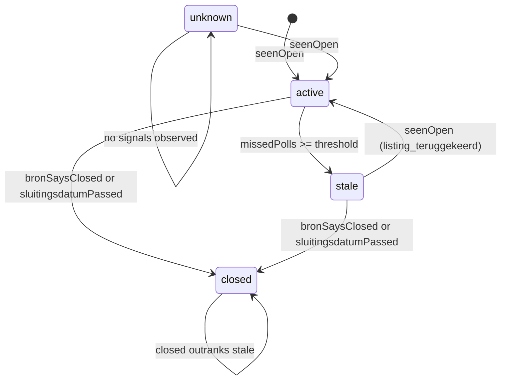

# Slice A Domain Model

The Slice A domain model focuses on the core concepts for job vacancy intelligence: the Aanvraag (job vacancy/request) and the Contactpersoon (contact person), along with supporting concepts like the Boolean query parser used for searching vacancies and the normalization of contact person data.

## Aanvraag

An **aanvraag** is the normalised vacancy record derived from source observations. It is unique per `(bron_id, bron_referentie)`. The Aanvraag includes:

- **lifecycle status**: one of `active`, `stale`, `closed`, `unknown` (see [Aanvraag lifecycle](#aanvraag-lifecycle))
- **bron categorie**: the category of the source (e.g., `msp_broker`, `global_msp`, etc.)
- **extractie methode**: the method used to extract the data (e.g., `api`, `jsonld`, `html_parser`, `llm`)
- **tarief eenheid**: the unit of the rate (e.g., `uur`, `dag`, `maand`)
- **money fields**: for tariefMin, tariefMax, etc., represented as `{ amount: string | null, currency: string }`
- **contactpersonen**: an array of `Contactpersoon` objects (see [Contactpersoon](#contactpersoon))
- **fields with UNKNOWN and CLEARED provenance**: such as `startDatum`, `eindDatum`, `tariefMin`, `tariefMax`, `bronUrl`, `locatieTekst`, `opdrachtgeverNaam` (see [Provenance discipline](#provenance-discipline))

The public schemas for Aanvraag are defined in `packages/domain/src/aanvraag.ts` using Effect Schema.

### Aanvraag lifecycle

The lifecycle of an aanvraag is modelled as a finite state machine with four states. The transitions are determined by pure functions in `packages/domain/src/lifecycle.ts`.



The `resolveLifecycleStatus` function derives the next state from inputs such as `bronSaysClosed`, `sluitingsdatumPassed`, `seenOpen`, `missedPolls`, etc.

## Contactpersoon

A **Contactpersoon** represents a contact person as published on a vacancy by a source. The canonical shape is defined in `packages/domain/src/aanvraag.ts`:

```ts
export const ContactpersoonSchema = Schema.Struct({
  email: Schema.NullOr(Schema.String),
  geinformeerdOp: Schema.NullOr(Schema.String),
  naam: Schema.NullOr(Schema.String),
  notificatieKanaal: Schema.NullOr(Schema.String),
  rol: Schema.NullOr(Schema.String),
  telefoon: Schema.NullOr(Schema.String),
});
```

The pipeline-owned fields `geinformeerdOp` and `notificatieKanaal` start as `null` and are used for the article 14 disclosure trail.

### Normalization and deduplication

The normalization of contact person data is handled in `packages/application/src/normalise/contactpersonen.ts`:

- `toContactpersoon`: maps a raw source contact (or schema.org `ContactPoint`) to the canonical `Contactpersoon` shape, rejecting contacts that lack a reachable channel (email/telefoon) or a name with a role.
- `pushUniqueContactpersonen`: adds a contact to a list only if it is not already present, using a dedup key of `(naam, email, telefoon)`.
- `mergeContactpersonenPipelineVelden`: when updating an existing contactpersonen list, carries forward the pipeline-owned fields (`geinformeerdOp`, `notificatieKanaal`) for contacts that retain the same `(naam, email, telefoon)` identity.
- `toDraftContactpersonen`: processes a connector's `contactpersonen` list according to the bron's `contactpersoon_beleid.extractie`, maps, deduplicates, and returns a normalized field for the curation pipeline.

## Boolean query parser

The Boolean parser (`packages/domain/src/boolean`) parses recruiter free-text queries into a `BooleanNode` AST that the search adapter consumes. The parser is stable: `BOOLEAN_PARSER_VERSION` is `1` and is carried in every successful parse result.

The AST node types are:

| node | shape |
| --- | --- |
| `BooleanTerm` | `{ kind: "term", value: string }` |
| `BooleanPhrase` | `{ kind: "phrase", value: string }` |
| `BooleanNot` | `{ kind: "not", operand: BooleanNode }` |
| `BooleanAnd` | `{ kind: "and", operands: BooleanNode[] }` |
| `BooleanOr` | `{ kind: "or", operands: BooleanNode[] }` |

The parser is a hand-written tokenizer plus recursive-descent parser with the following properties:

- **Tokens**: `term`, `phrase`, `lparen`, `rparen`, `or`, `and`, `not`, `eof`.
- **Keywords**: `OR`, `AND`, `NOT` — matched case-insensitively, but only when not part of a larger term.
- **Phrases**: double-quoted, with backslash escapes for embedded quotes.
- **Precedence**: `NOT` binds tightest, then `AND` (explicit and implicit — adjacent terms without an operator form an `AND`), then `OR`.
- **Implicit AND**: a term/phrase/`NOT`/`(` immediately following another primary is an implicit `AND`.
- **Grouping**: parentheses group; an unclosed `(` is a parse error.
- **Errors**: every error is `{ code: "syntax_error", message, offset }`, including `Query must not be empty`, `Unclosed phrase`, `Unclosed parenthesis`, `Missing operand before AND/OR`, and `Unexpected end of query`.

`parseBooleanQuery` returns a discriminated union: `{ ok: true, ast, version }` on success or `{ ok: false, error }` on failure.

## Provenance discipline

When a source genuinely does not publish a field, the field is set to the `UNKNOWN` sentinel (`"unknown"`) with honest provenance. This is distinct from `CLEARED` (`"cleared"`), which is an explicit tombstone that overwrites a last-known curated value with `null`.

In the context of Aanvraag, fields such as `startDatum`, `eindDatum`, `tariefMin`, `tariefMax`, `bronUrl`, `locatieTekst`, and `opdrachtgeverNaam` use the `UNKNOWN` sentinel when the source does not publish them. The `NormalisedTarief` subfields (`eenheid`, `max`, `min`) can be `TariefEenheid | typeof CLEARED | typeof UNKNOWN`.

This distinction ensures that a field that was never published (`UNKNOWN`) is not confused with a field that was published and then intentionally cleared (`CLEARED`).

## Opaque ids

All domain ids are plain strings (not UUID-validated) to keep existing non-UUID fixtures and operator refs working. The relevant ids for Slice A are:

- `BronId`: identifies a configured bron.
- `AanvraagId`: identifies a normalised vacancy.

These are defined in `packages/domain/src/ids.ts` and validated by the `DomainIdString` Effect Schema.

## Schema helpers

The `schema-helpers.ts` file provides shared Effect Schema primitives (like `NonEmptyString`, `DomainIdString`, `BronReferentieSchema`) used to build the Aanvraag and Contactpersoon schemas. The `BRON_REFERENTIE_MAX_LENGTH` (2000) and `BRON_NAAM_MAX_LENGTH` (200) caps reflect physical btree index limits.
